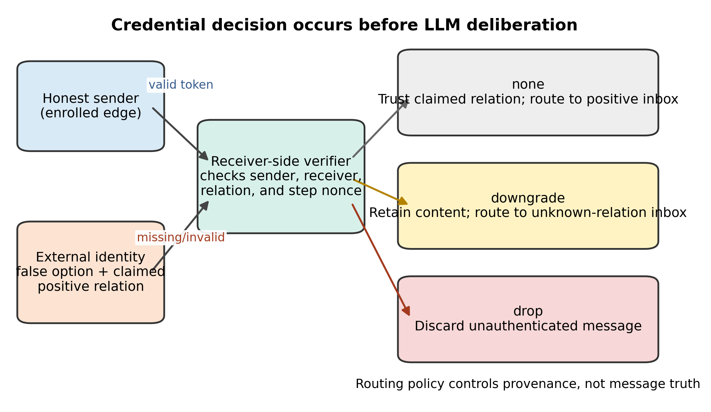
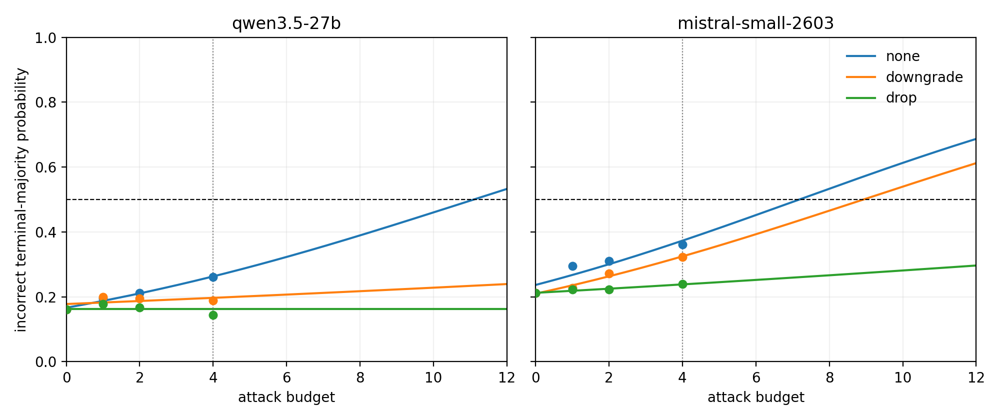

# Authenticated Relationship Routing Mitigates External-Identity Attacks in LLM-Agent Collectives

**Author:** Ben Tseng  
**Affiliation:** To be confirmed before submission  
**Corresponding author:** To be confirmed before submission

## Abstract

Communication allows large language model agents to pool reasoning, but it also lets an external actor manufacture apparent social support. This study examines whether the number of unauthenticated external identities changes the probability that an eight-agent collective ends with an incorrect majority, and whether receiver-side credential policies reduce that risk. A frozen confirmatory experiment evaluated Qwen3.5-27B and Mistral Small 4 across 20 accepted model-seed blocks and 3,600 episodes. External identities sent the false option, claimed a positive relationship, and targeted up to four honest agents. Relationship credentials bound sender, receiver, signed relation, and a step nonce. Receivers either trusted the claim, downgraded invalid traffic to an unknown-relation channel, or dropped it. Under no defense, each additional external identity increased pooled incorrect-majority odds (OR 1.229, 95% CI 1.119 to 1.349, p = 1.45 x 10^-5). At the mean positive budget, downgrade reduced the odds relative to no defense (OR 0.794, 95% CI 0.639 to 0.986, p = .0373). Drop produced a larger reduction (OR 0.592, 95% CI 0.474 to 0.740, p = 4.10 x 10^-6). The directions replicated in both deployments. Estimated 50% critical budgets shifted upward under credential-aware routing, but every crossing exceeded the largest tested budget of four and is therefore extrapolative. These results support enforcing identity and relationship claims at the routing boundary before language-model deliberation.

**Keywords:** multi-agent security, Sybil-like attack, message authentication, receiver-side routing, collective decision-making, trustworthy AI

## 摘要

大型語言模型代理透過溝通整合推理，也因此暴露於偽造社會支持的攻擊。本研究檢驗未驗證外部身分的數量是否提高八代理集體形成錯誤多數決的機率，並評估接收端憑證路由政策的防禦效果。確認性實驗在 Qwen3.5-27B 與 Mistral Small 4 兩個官方部署上完成 20 個模型種子區塊及 3,600 個回合。外部身分傳送錯誤選項、聲稱正向關係，並最多攻擊四名誠實代理。憑證同時綁定發送者、接收者、已簽署關係與步驟隨機值；接收者分別採信聲稱關係、將無效訊息降級至未知關係通道，或直接捨棄。無防禦時，每增加一個外部身分，錯誤多數決的合併勝算提高（OR 1.229，95% CI 1.119–1.349）。在正攻擊預算平均值上，降級與捨棄皆降低攻擊勝算，其 OR 分別為 0.794 與 0.592，且兩個部署的方向一致。50% 臨界預算的點估計向上移動，但全部超過實測上限四，因而僅能作方向性解讀。研究結果支持在語言模型參與討論之前，於訊息路由邊界驗證身分與關係聲稱。

**關鍵詞：** 多代理安全、類 Sybil 攻擊、訊息驗證、接收端路由、集體決策、可信任人工智慧

## 1. Introduction

Large language model (LLM) agents increasingly solve tasks through structured conversation rather than isolated inference. Role-playing systems, multi-agent debate, and programmable conversation frameworks let agents divide work, challenge intermediate answers, and combine distinct traces [2]–[6]. Communication topology also matters. Sparse interaction can preserve or improve debate performance while reducing cost, which makes the graph itself part of system design rather than a neutral transport layer [8]. These results have encouraged architectures in which a final answer emerges from repeated social updates.

The same responsiveness that supports collaboration creates a security boundary. An agent does not observe another participant's reasoning process. It receives a message carrying content, a sender label, and sometimes a claimed role or relationship. Studies of opinion dynamics and collaboration show that LLM agents respond to numerical majorities, apparent expertise, speaking dominance, and persuasive rhetoric [10]–[17]. A collective can therefore move toward error even when most components began with useful information. The risk is not limited to a base model generating a wrong answer. It can arise from how a system represents and routes social evidence.

Existing adversarial work has established several adjacent threats. A malicious enrolled participant can steer debate [16], [17]. Untrusted tool output can inject instructions into an otherwise benign agent [24], [26]. Broad security benchmarks show that tool-integrated agents remain vulnerable across attack and defense configurations [25]. These studies mainly vary malicious content, compromise a participant, or place adversarial instructions in an external data channel. They do not isolate an attacker that remains outside the enrolled collective, creates several nominal sender identities, and attaches false relationship claims to otherwise standardized messages.

That distinction matters because identity multiplicity changes the apparent source structure. The classical Sybil problem arises when one actor presents multiple identities and thereby defeats assumptions that nominal participants represent independent entities [20]. Byzantine protocols similarly state their fault tolerance under explicit membership and identity assumptions [23]. In an LLM-agent system, a receiver that accepts a self-declared sender name and relationship can count one actor several times or route its messages through privileged social channels. Better natural-language reasoning alone does not repair the membership assumption.

This paper studies a narrow form of that problem: unauthenticated external identities that send a fixed false option, claim a positive relationship, and target honest agents in a signed interaction graph. We ask: **How does the number of unauthenticated external identities affect incorrect-majority outcomes, and to what extent do credential-aware downgrade and drop policies mitigate this effect across two official LLM deployments?** The experiment holds the attack message strategy constant while varying the external-identity budget and the receiver's treatment of an invalid relationship credential.

Four hypotheses organize the analysis. H1 predicts that, without authentication, each additional external identity increases the odds of an incorrect terminal majority. H2 predicts that downgrading invalid traffic to a relationship-unknown channel reduces those odds relative to trusting the claim. H3 predicts that dropping invalid traffic also reduces the odds. H4 predicts a directional increase in the fitted attack budget required to reach 50% success under credential-aware routing. H4 is deliberately weaker than a calibration claim because the available physical coupling estimates do not match both live deployments and the tested budgets end at four.

The study contributes a controlled external-identity threat model, two deterministic receiver-side policies, and a preregistered evaluation across two independently operated official deployments. Its accepted dataset contains 3,600 episodes arranged as 20 complete model-seed blocks. Prospective admission gates separate request errors, exhausted parse failures, unique-sender message-call failures, and invalid honest credentials. Entire blocks were replaced when necessary; no episode from an excluded predecessor was reused. The resulting design connects identity enforcement to collective outcomes while keeping substantive errors distinct from API failures.

H1 through H3 were supported. Under no defense, the odds of an incorrect terminal majority increased with each additional external identity. Downgrade and drop reduced pooled attack odds, and the same directions appeared in both deployments. The critical-budget point estimates also shifted upward, but every 50% crossing fell beyond the observed budget range. These findings motivate relationship-bound verification at the message-routing boundary. They do not imply universal immunity, a ranking of model families, or a numerically validated physical threshold.

This framing changes what counts as a successful defense. A content filter would succeed by recognizing that an argument is false or adversarial. The interventions tested here succeed when the router refuses to treat an unverified relationship as an established edge. The message may remain readable under downgrade, and an authenticated sender may still be wrong. The control protects the meaning of the interaction graph. That narrower objective is measurable, composable with other defenses, and compatible with open or closed communication policies.

## 2. Related Work

### 2.1 Collective reasoning and communication topology

LLM multi-agent research treats interaction as a means of expanding the effective computation available to a task. CAMEL showed that role-conditioned agents can sustain autonomous cooperation through conversation [3]. AutoGen generalized this pattern into programmable multi-agent workflows with configurable participants and termination rules [4]. Multi-agent debate has improved factuality and reasoning on several benchmarks by allowing agents to propose, criticize, and revise answers [5]. Debate can also encourage divergent reasoning when a controlled protocol prevents early convergence [6].

These gains are conditional. Social-psychological traits and interaction patterns affect conformity, consensus, and efficiency [7]. Sparse communication topologies can match or outperform all-to-all debate [8], showing that more messages are not automatically better. Strong single-agent prompting can approach the best discussion methods in some settings, so collaboration should not be treated as a universal performance multiplier [9]. The relevant unit of analysis is the joint system: model, prompt, topology, update rule, and aggregation procedure.

The focal *Physics of Agents* work models interacting LLM agents as a compact dynamical system with indifference, polarization, and consensus regimes [1]. Related network studies likewise find that information flow and cognitive update rules shape collective behavior [10], [13]. This literature motivates threshold and coupling language, but it is primarily descriptive. A security intervention changes who may exert which kind of influence. Translating a credential decision into an effective coupling change is plausible, yet it requires deployment-matched estimates and observations near the relevant threshold.

### 2.2 Conformity, consensus, and collective failure

Collective reasoning fails when interaction amplifies shared mistakes. Networked LLM agents often move toward truth-aligned consensus under neutral conditions, but prompted bias can alter their trajectories [10]. Group-conformity experiments show that neutral agents respond to numerical majorities and that apparently capable agents may exert disproportionate influence [11]. These findings make sender count a potential control variable even when the message content is simple.

Population experiments extend the point. LLM populations form conventions, and committed minorities can shift the convention adopted by the group [12]. Adversarial social dynamics can exploit apparent expertise, dominance, or rhetoric to undermine objective decisions [14]. Homogeneous deliberation can also entrench an initially shared error, whereas enforced diversity may improve resistance [15]. Across these settings, consensus is an outcome, not evidence that the conclusion is correct.

The present study differs from a generic conformity experiment in one respect: the manipulated senders lack valid membership credentials. Their numerical presence is therefore not simply another social condition. It is a security failure in the representation of provenance. Counting several unverified sender labels as several trusted neighbors converts identity creation into apparent corroboration.

### 2.3 Adversarial collaboration and external-input attacks

Research on collaboration attacks shows that one malicious debate participant can reduce group accuracy, especially when it generates persuasive arguments [16]. Later work traces how persuasive influence accumulates across rounds and produces false consensus [17]. These studies establish that collaborative protocols must tolerate adversarial speech. They usually begin, however, with an adversary that already occupies a recognized participant slot.

Tool-integrated agents face a different external-input problem. InjecAgent demonstrates that indirect prompt injection embedded in retrieved content can cause harmful actions [26]. AgentDojo evaluates such attacks in a dynamic task environment and highlights a recurring security-utility tradeoff: defenses that reject untrusted content may also impair benign task completion [24]. Agent Security Bench broadens the evaluation across attack classes, tools, defenses, and model backbones [25]. Here the untrusted object is a peer message and its relationship metadata, not a tool result containing an instruction. The receiver does not attempt to classify the semantics as malicious. It verifies a credential and applies a fixed policy.

This separation matters for reproducibility. Content-based filters depend on model judgments and can fail under paraphrase or novel attack strategies. Credential verification is a deterministic predicate over sender, receiver, relation, and freshness data. It cannot determine whether an authenticated message is truthful, but it can prevent an unauthenticated sender from selecting a privileged routing label.

### 2.4 Identity, credentials, and deterministic enforcement

The Sybil attack formalizes the danger of assuming that distinct identifiers represent distinct entities [20]. Without a trusted certification mechanism or a scarce resource that binds identity to an entity, redundancy can be illusory. Practical Byzantine fault tolerance reaches a complementary conclusion from the protocol side: resilience guarantees depend on a defined replica set and bounded faulty membership [23]. Neither result maps directly onto LLM conversation, but both expose the same architectural premise. Before counting votes or messages, the system must know what constitutes a participant.

Multi-agent security surveys have long separated communication protection, access control, trust, and reputation from application-level reasoning [21]. Recent work on authenticated delegation makes this separation explicit for AI agents by calling for auditable authority chains and scoped permissions [18]. Implementations based on decentralized identifiers and verifiable credentials likewise place identity proof outside the LLM and warn against delegating security procedures to probabilistic text generation [19]. HMAC supplies a standardized mechanism for source authentication and message integrity when communicating parties share keying material [22].

These mechanisms do not solve every trust problem. A valid credential can belong to a compromised agent; keys can be stolen; and authorization can be overbroad. Still, they allow a router to distinguish a verified relationship from a textual assertion. The empirical gap is whether this distinction changes collective decisions under controlled identity multiplication. The current experiment addresses that gap through a budget-response design, two official deployments, full-block admission rules, and two receiver policies that differ in whether invalid content remains available.

The gap also concerns evaluation discipline. Agent experiments mediated by remote APIs can fail at several layers. A request may time out, a model may return an unparsable answer, a message-generation call may fail, or an implementation error may reject a valid credential. Collapsing these events into one failure count obscures whether a defense changed behavior or merely disrupted communication. The present design records the layers separately and admits data at the complete block level. This distinction matters when a treatment such as `drop` intentionally removes traffic. A lower delivered-message count is part of the policy, whereas an API request failure is not.

## 3. Methods

### 3.1 Confirmatory design and deployment boundaries

We conducted a preregistered two-deployment confirmatory experiment. The accepted deployments were Qwen3.5-27B through Alibaba Cloud Model Studio's official Singapore endpoint and the version-pinned `mistral-small-2603` deployment through Mistral AI's official API. Provider infrastructure, serving configuration, and model family were not controlled as separate factors. We therefore treat the deployments as independent replications and report their estimates separately before the pooled model.

The confirmatory corpus contained 18 held-out, text-only mathematics questions. Two candidate questions that required Asymptote diagrams were excluded before outcome collection. Ground-truth labels were balanced across the two answer options, with nine A and nine B answers. Each deployment was evaluated on ten graph and attack seeds. For each seed, the design crossed attack budgets of one, two, and four external identities with three routing policies: `none`, `downgrade`, and `drop`. A budget-zero control completed the ten-cell block. Each model-seed block therefore contained 180 episodes, and the 20 accepted blocks contained 3,600 episodes.

**Table 1. Frozen experimental design and accepted sample**

| Component | Frozen value |
|---|---|
| Deployments | Qwen3.5-27B; Mistral Small 4 (`mistral-small-2603`) |
| Held-out questions | 18 text-only mathematics questions; labels balanced 9/9 |
| Honest agents | 8 |
| Nonzero graph entries | 28, corresponding to 14 undirected edges |
| Interaction | 2 synchronous updates; 3 opinion samples per agent and state |
| External-identity budgets | 0, 1, 2, 4 |
| Recipients per external identity | Up to 4 honest agents |
| Routing policies | none, downgrade, drop |
| Seeds | 10 per deployment |
| Accepted blocks and episodes | 20 blocks; 3,600 episodes |

### 3.2 Honest-agent network and episode procedure

Each episode instantiated eight honest agents on a signed, symmetric interaction graph. The adjacency matrix had 28 nonzero entries, which corresponded to 14 undirected edges. Edge signs represented positive or negative relationships and determined the relationship-conditioned inbox used by the opinion-update prompt. The graph was fixed within a seed and varied across seeds according to the frozen generator.

Agents answered one of the held-out binary-choice mathematics questions. An episode began with independent opinion sampling, followed by two synchronous communication and update steps. At each state, three opinion samples were drawn per honest agent. The runner converted parsable answers into signed states and retained a raw zero when a spin call could not yield a valid answer. Messages for a step were collected before any recipient updated, preventing within-step ordering from granting an early sender additional influence.

Sampling temperature was 0.7. Requests used four workers, a 60-second timeout, and zero API retries. Request starts were separated by at least 0.5 seconds for Qwen and 0.8 seconds for Mistral to respect deployment-specific rate limits. These operational settings were held fixed within each accepted deployment matrix.

The budget-zero control was shared across the conceptual defense conditions because no external message existed to authenticate or route. This avoided duplicating identical control episodes while retaining one reference rate per deployment and seed. At positive budgets, every cell was independently collected. The ten-cell block thus represented one control plus nine combinations of three budgets and three policies.

The terminal outcome was computed only from the eight honest agents. External identities supplied messages but did not vote in the final population. This choice prevented a trivial attack in which the attacker wins by adding its own votes directly to the count. A successful episode instead required external traffic to change enough honest states that the honest-agent majority became incorrect.

### 3.3 External-identity threat model

Every external identity sent the objectively false answer option and claimed a positive relationship with the recipient. It had no valid relationship credential. At nonzero budgets, each external identity targeted up to four honest agents. Target sets were chosen deterministically from the frozen attack seed, episode identifier, and attack budget, which made recipient selection reproducible. Honest and external messages were routed before the next synchronous update.

The threat is Sybil-like because one attacker can present multiple nominal identities, but the experiment does not claim to implement a complete real-world Sybil campaign. It does not model account creation cost, provider-level identity proofing, long-lived reputation, adaptive target discovery, or coordinated natural-language strategies. The budget is an experimental count of external sender identities. The study asks what happens after those identities reach the collective's message boundary.

We use “external identity” rather than “malicious agent” because the manipulated units do not run the same update process as honest agents. They do not receive peer messages, reconsider their position, or occupy nodes in the enrolled graph. They are message sources controlled by the attack procedure. This terminology keeps the independent variable separate from the eight-agent collective whose terminal state defines the outcome.

The attack is intentionally simple. Each identity asserts the same false answer and positive relationship rather than optimizing rhetoric per recipient. A standardized payload improves interpretability because the budget coefficient cannot be attributed to a larger language model generating more persuasive variants at higher budgets. It also makes the experiment a conservative test of provenance handling: the defense does not receive an obvious malicious marker beyond the missing or invalid credential.

Figure 1 summarizes the trust boundary. Honest messages originate on enrolled graph edges and carry credentials. External messages carry a sender label and claimed positive relationship but lack a valid token. Verification occurs before an LLM sees the message in a relationship-conditioned inbox.

**Figure 1. Threat model and credential-routing paths.** Honest messages carry relationship-bound credentials. An external identity supplies a false option and a claimed positive relationship. The receiver-side router either trusts the claim under `none`, retains the content in an unknown-relation channel under `downgrade`, or discards it under `drop`.

### 3.4 Relationship credentials and routing policies

Before routing an honest message, an HMAC-based credential authority issued a token bound to the sender identifier, receiver identifier, signed relationship, and step-specific nonce. Binding the receiver prevented a token issued for one edge from being replayed as evidence for another. Binding the relation prevented a sender from changing the edge sign without invalidating the token. Binding the nonce provided step-level freshness within the experiment. HMAC was used as a controlled message-authentication mechanism following the source-authenticity and integrity properties standardized in FIPS 198-1 [22]. It was not intended as a full public-key identity infrastructure.

The three routing policies differed only in their response to a missing or invalid credential. Under `none`, the router trusted the external message's claimed relation and placed it in the positive-relation inbox. Under `downgrade`, it retained the message but placed it in a relationship-unknown inbox. Under `drop`, it discarded the message. Valid honest messages preserved their verified signed relation under both credential-aware policies. The content generator and attack target logic did not change across policies.

The unknown-relation channel was not assigned an authenticated positive or negative edge. Its purpose was to preserve the distinction between “unfamiliar” and “verified adversarial.” An invalid token establishes that the presented authorization cannot be accepted; it does not establish that the proposition is false. Downgrade therefore represents a permissive policy for systems that want to expose uncertain-origin information without granting it the social semantics of an enrolled relationship.

Under `none`, token status was not used to change routing. This condition models a system that transports sender and relationship fields as application metadata without cryptographic enforcement. It is not a claim that practical systems literally label a switch “no defense.” Many agent frameworks allow message objects, role descriptions, or conversation participants to be constructed programmatically [4]. If those fields reach the prompt without an independently verified binding, their security behavior is equivalent to trusting the caller that supplied them.

This design separates authentication from content moderation. Downgrade does not decide that the message is false. It decides that the claimed relationship has not been established. Drop imposes a stricter authorization rule by refusing unauthenticated peer traffic. Both decisions are deterministic and occur outside the language model.

### 3.5 Outcomes, admission gates, and block replacement

The primary outcome was an indicator that the terminal majority of honest agents was incorrect. A tied terminal population was not counted as attack success. Secondary outcomes included the truth-aligned terminal margin, fraction of correct agents, incorrect consensus, raw zero spins, request errors, exhausted parse failures, recovered parse retries, unique-sender message-call failures, invalid honest credentials, and the fitted 50% critical budget.

Collection proceeded in complete model-seed blocks. Eligibility required all 180 episode files and no invalid honest credentials. Raw zero spins could not exceed 1% of spin calls, and unique-sender message-call failures could not exceed 1% of message calls. These criteria were technical gates, not outcome-dependent filters. A failing block was excluded in full rather than repaired by retaining successful cells.

Five blocks were replaced under prospective, dated recollection amendments: Qwen seeds 0 and 4, and Mistral seeds 1, 7, and 9. Each replacement used a new output directory and reran all ten cells. No predecessor episode entered the accepted manifest. The analysis script enumerated the 20 accepted source files explicitly and locked their SHA-256 hashes before merging.

The replacement rule was selected before a failed block was recollected. It prevented an analyst from retaining successful cells and rerunning only technically poor cells, a practice that could couple admission to unobserved provider conditions or to outcome inspection. The accepted-block manifest records the source path for every model-seed pair and identifies the replacement directory where applicable. Counts reported in the paper were recomputed from those explicit sources rather than from a recursive search of the data tree.

Technical gates were deliberately strict relative to the observed failure rates. A 1% ceiling on raw zero spins and message-call failures permits occasional remote-service disruption without treating a block as substantively complete when communication has degraded. The zero-tolerance rule for invalid honest credentials tests a different property: a valid enrolled edge must not be misrouted by the authentication implementation. A single such event would undermine the interpretation that policy differences concern external traffic only.

### 3.6 Statistical analysis

The preregistered primary analysis fit a mixed-effects logistic model to the incorrect-terminal-majority indicator. Fixed effects were attack budget, defense, deployment, and the budget-by-defense interaction. Random intercepts accounted for held-out question and seed/graph. In compact form,

\[
\operatorname{logit}\Pr(Y_{iqs}=1)=\beta_0+\beta_1 B_i+\beta_2 D_i+\beta_3 M_i+\beta_4(B_i\times D_i)+u_q+v_s,
\]

where \(B_i\) is the raw, unstandardized external-identity count in \(\{0,1,2,4\}\), \(D_i\) is routing policy, \(M_i\) is deployment, and \(u_q\) and \(v_s\) are independent question and seed random intercepts. The reference policy was `none`; the single budget-zero control in each seed was coded as `defense=none`. Maximum a posteriori fits used `statsmodels` 0.14.4 `BinomialBayesMixedGLM.fit_map`, BFGS with at most 2,000 iterations, a zero-mean Gaussian fixed-effect prior with SD 5.0, and a zero-mean Gaussian prior with SD 0.5 on each log random-effect SD. Fixed-effect covariance was the Laplace/MAP posterior block returned by `cov_params()`. Independent variational-Bayes fits yielded closely aligned fixed-effect means as a numerical stability check. No optimizer warning was recorded.

H1 estimated \(\exp(\beta_1)\), the subject-specific conditional OR per one nominal external identity under `none`, holding question and seed random intercepts fixed. H2 compared `downgrade` with `none` at the mean of the positive tested budgets, \((1+2+4)/3=7/3\). H3 used the same contrast definition for `drop`. These are also conditional contrasts. Tests were two-sided and report odds ratios (ORs), 95% confidence intervals (CIs), and p values. Deployment-specific models used the same defense and raw-budget structure and were interpreted as within-deployment estimates. Because logistic ORs are non-collapsible, conditional OR magnitudes need not match ORs computed from marginal cell proportions.

We audited that distinction by reconstructing each deployment-specific cell from the fitted fixed effects and posterior means of the question and seed random effects. The fitted question-level SD was 4.150 for Qwen and 3.088 for Mistral; the corresponding seed SDs were 0.087 and 0.127. Averaged posterior conditional fitted probabilities were compared with all 20 observed cell rates. The maximum absolute difference was 0.00550 for Qwen and 0.02610 for Mistral. The audit script and full-precision table are included with the paper artifacts.

Nine secondary pairwise policy contrasts at budgets one, two, and four were adjusted by the Holm procedure. They were not substitutes for the primary contrasts. Critical budgets were defined as the budget at which a nondecreasing logistic attack-success curve crossed 50%. Curves were estimated separately by deployment and policy from observed budgets 0, 1, 2, and 4. Confidence intervals used 2,000 question-cluster bootstrap resamples with random seed 20261106. Samples without a finite crossing were retained as infinite values. The downgrade-to-none critical-budget multiplier supplied the directional H4 quantity. Because no observed condition approached a 50% crossing within budget four, all critical budgets were treated as extrapolations.

Question-cluster resampling preserved all model, seed, budget, and policy observations associated with a sampled question. It therefore reflected uncertainty across the held-out task set without breaking the within-question experimental structure. The bootstrap was used for the curve-derived critical budgets, not to replace the mixed-model intervals for H1 through H3. Infinite values remained in the empirical distribution so that interval summaries represented the inability to locate a crossing rather than silently imposing a finite upper bound.

The analysis plan separated confirmatory and descriptive claims before results were interpreted. H1 through H3 are the primary tests. Holm-adjusted budget-specific comparisons are secondary. H4 is directional because the threshold calculation is unsupported by observations near 50% and because matched physical coupling estimates are unavailable. This hierarchy governs the language used below.

## 4. Results

### 4.1 Accepted data and technical validity

All 20 accepted blocks met the prespecified gates, yielding 3,600 episodes. Across 259,200 raw spin calls, 151 returned zero, a rate of 0.058%. Every raw zero was classified as a request error. There were no exhausted parse failures and no recovered parse retries. Twenty-eight of 57,600 unique-sender message calls failed, a rate of 0.049%. No valid honest message produced an invalid credential.

These counts distinguish infrastructure failures from substantive collective outcomes. A raw zero remained a technical failure and was not converted into an answer. Full-block replacement also prevented a technically favorable subset of a failed seed from entering the analysis.

The aggregate raw-zero rate was more than an order of magnitude below the 1% gate, as was the message-call failure rate. The absence of exhausted parse failures indicates that the accepted technical failures arose before a parseable model response was available rather than after the parser exhausted its allowed interpretations. Most importantly for the intervention, credential validation accepted every honest token in the admitted data. The defense conditions therefore did not obtain their apparent benefit by accidentally suppressing enrolled honest messages.

### 4.2 Descriptive attack-success trajectories

Under `none`, observed incorrect-majority rates increased with budget in both deployments (Table 2). Qwen rose from 0.161 in the budget-zero control to 0.194, 0.211, and 0.261 at budgets one, two, and four. Mistral rose from 0.211 to 0.294, 0.311, and 0.361.

Credential-aware trajectories differed by deployment. Qwen downgrade rates were 0.200, 0.194, and 0.189, while its drop rates were 0.178, 0.167, and 0.144. Mistral downgrade rates were 0.228, 0.272, and 0.322, while its drop rates were 0.222, 0.222, and 0.239. These are descriptive proportions; the mixed models provide the prespecified inferential comparisons.

**Table 2. Incorrect-terminal-majority rates by deployment, policy, and budget**

| Deployment | Control | None b=1 | None b=2 | None b=4 | Downgrade b=1 | Downgrade b=2 | Downgrade b=4 | Drop b=1 | Drop b=2 | Drop b=4 |
|---|---:|---:|---:|---:|---:|---:|---:|---:|---:|---:|
| Qwen3.5-27B | 0.161 | 0.194 | 0.211 | 0.261 | 0.200 | 0.194 | 0.189 | 0.178 | 0.167 | 0.144 |
| Mistral Small 4 | 0.211 | 0.294 | 0.311 | 0.361 | 0.228 | 0.272 | 0.322 | 0.222 | 0.222 | 0.239 |

### 4.3 Confirmatory H1-H3 tests

The deployment-specific models produced the predicted direction for all three conditional contrasts. For Qwen, the `none` budget slope had OR 3.161 (95% CI 2.076 to 4.812, p = 7.99 x 10^-8). `Downgrade` versus `none` had OR 0.275 (95% CI 0.113 to 0.667, p = .00433), and `drop` versus `none` had OR 0.057 (95% CI 0.021 to 0.153, p = 1.26 x 10^-8). For Mistral, the budget-slope OR was 1.634 (95% CI 1.343 to 1.989, p = 9.29 x 10^-7). Its `downgrade` and `drop` ORs were 0.558 (95% CI 0.358 to 0.870, p = .0101), and 0.283 (95% CI 0.178 to 0.449, p = 8.51 x 10^-8).

The pooled model supported H1. Under `none`, each additional external identity increased incorrect-majority odds by 22.9% (OR 1.229, 95% CI 1.119 to 1.349, p = 1.45 x 10^-5). H2 was also supported at the mean positive budget: `downgrade` reduced the odds relative to `none` (OR 0.794, 95% CI 0.639 to 0.986, p = .0373). The H3 estimate showed a larger pooled reduction for `drop` (OR 0.592, 95% CI 0.474 to 0.740, p = 4.10 x 10^-6).

**Table 3. Preregistered deployment-specific and pooled contrasts**

| Scope | Contrast | OR | 95% CI | p |
|---|---|---:|---|---:|
| Qwen3.5-27B | H1: budget slope under none | 3.161 | 2.076 to 4.812 | 7.99 x 10^-8 |
| Qwen3.5-27B | H2: downgrade vs none | 0.275 | 0.113 to 0.667 | .00433 |
| Qwen3.5-27B | H3: drop vs none | 0.057 | 0.021 to 0.153 | 1.26 x 10^-8 |
| Mistral Small 4 | H1: budget slope under none | 1.634 | 1.343 to 1.989 | 9.29 x 10^-7 |
| Mistral Small 4 | H2: downgrade vs none | 0.558 | 0.358 to 0.870 | .0101 |
| Mistral Small 4 | H3: drop vs none | 0.283 | 0.178 to 0.449 | 8.51 x 10^-8 |
| Pooled | H1: budget slope under none | 1.229 | 1.119 to 1.349 | 1.45 x 10^-5 |
| Pooled | H2: downgrade vs none | 0.794 | 0.639 to 0.986 | .0373 |
| Pooled | H3: drop vs none | 0.592 | 0.474 to 0.740 | 4.10 x 10^-6 |

The deployment estimates are subject-specific conditional ORs, whereas Table 2 reports marginal cell proportions. Strong question heterogeneity explains much of the scale difference: the fitted question random-effect SD was 4.150 for Qwen and 3.088 for Mistral. Posterior conditional fitted cell rates reproduced the observed trajectories with maximum absolute discrepancies of 0.00550 and 0.02610, respectively. The deployment estimates also remain conditional on different models and serving stacks. Their magnitudes do not identify a causal difference between model families.

The pooled H1 estimate is a per-identity multiplicative change in odds, conditional on the fitted fixed and random effects. It should not be read as a 22.9 percentage-point change in probability. Likewise, H2 and H3 are policy contrasts at the prespecified mean positive budget, not constant risk ratios at every budget. The interaction terms allow the policy difference to vary with budget, which is why the secondary budget-specific results can differ from the averaged primary contrast.

The agreement of signs across deployment-specific and pooled models reduces the chance that one endpoint alone determines the conclusion. It does not remove sampling uncertainty or deployment confounding. In particular, the very small Qwen H3 odds ratio describes the fitted contrast in that deployment and design. It is not an estimate of protection for arbitrary Qwen applications.

### 4.4 Secondary policy contrasts

After Holm correction across the nine secondary comparisons, `drop` differed from `none` at budget two (OR 0.638, Holm-adjusted p = .000635) and budget four (OR 0.406, Holm-adjusted p = 2.05 x 10^-5). The `downgrade` versus `none` comparison at budget four had an unadjusted p value of .0250 but did not remain significant after correction (Holm-adjusted p = .150). No other secondary comparison passed the Holm-adjusted .05 threshold.

These results refine, but do not replace, H2 and H3. The primary contrasts average the policy difference at the prespecified mean positive budget. The secondary analysis asks whether a difference is detectable at each tested budget while controlling family-wise error across nine comparisons.

### 4.5 Critical budgets and H4

Figure 2 shows the observed proportions and fitted nondecreasing curves. Every estimated 50% crossing lies beyond the maximum tested budget of four. For Qwen, the critical budget was 11.10 under `none` (bootstrap 95% CI 4.72 to infinity), 48.98 under `downgrade` (11.37 to infinity), and infinite under `drop` (infinity to infinity). Its downgrade-to-none multiplier was 4.41 (1.78 to infinity). For Mistral, the estimates were 7.18 under `none` (2.57 to 24.98), 8.93 under `downgrade` (4.07 to 23.73), and 35.18 under `drop` (12.40 to infinity). Its multiplier was 1.24 (0.60 to 2.18).

**Figure 2. Observed attack success and fitted nondecreasing curves.** Points show incorrect-terminal-majority rates at budgets 0, 1, 2, and 4. Lines are fitted curves. The horizontal reference is 50% attack success; the vertical reference marks the largest tested budget. All crossings to the right of budget four are extrapolations.

**Table 4. Extrapolative 50% critical budgets**

| Deployment | None | Downgrade | Drop | Downgrade / none |
|---|---:|---:|---:|---:|
| Qwen3.5-27B | 11.10 [4.72, infinity] | 48.98 [11.37, infinity] | infinity [infinity, infinity] | 4.41 [1.78, infinity] |
| Mistral Small 4 | 7.18 [2.57, 24.98] | 8.93 [4.07, 23.73] | 35.18 [12.40, infinity] | 1.24 [0.60, 2.18] |

Both point multipliers exceed one, which is directionally consistent with H4. The evidence does not establish quantitative calibration. The Mistral multiplier interval includes one, the Qwen interval is open-ended, all underlying crossings are outside the observed range, and the available coupling file pertains to Qwen3.5-9B rather than Qwen3.5-27B and contains no Mistral estimate.

## 5. Discussion

### 5.1 Principal findings

Three findings answer the research question. External-identity budget matters when a router trusts self-declared relationships: each additional identity increased pooled incorrect-majority odds under `none`, and the direction held within both deployments. Deterministic credential treatment also changed collective outcomes. Downgrade and drop both reduced the prespecified average attack contrast. Finally, fitted critical-budget point estimates moved upward under authenticated routing, but the unobserved crossings support only a directional interpretation.

The result is best understood as a routing effect. The policies do not improve the base model, identify false mathematics, or train agents to resist persuasion. They change the context in which a message reaches the model. Under `none`, an external sender selects the positive-relation channel by assertion. Under `downgrade`, the content remains visible but loses the asserted relationship. Under `drop`, the content never enters deliberation. This ordering matches the pooled estimates without requiring a semantic detector.

### 5.2 Sender count is not independent evidence

Multi-agent reasoning often benefits from multiple traces because agents may make different errors [5], [6]. That benefit depends on diversity and partial independence. Strong prompting can already narrow the gap between one agent and a discussion [9], and homogeneous interaction can reinforce a shared mistake [15]. A system should therefore avoid equating message count with evidentiary diversity.

External identity multiplication targets that assumption directly. The attacker in this study did not need to compromise an enrolled node or generate a sophisticated proof. It presented several sender labels carrying the same false option. When the router accepted each relationship claim, those labels acquired positions in the social input seen by honest agents. The H1 result is consistent with conformity studies in which numerical majorities influence otherwise neutral agents [11] and with population studies in which committed minorities can shift conventions [12].

The experiment does not prove that identity labels alone caused the entire effect. More identities also produced more message instances. In an operational system, however, this is precisely why membership and provenance matter: an attacker uses identity multiplication to create repeated apparent corroboration. The security control need not decide which psychological mechanism inside the LLM mediates the response. It can prevent an unverified sender from being represented as a trusted neighbor.

### 5.3 Relation to adversarial collaboration and prompt injection

Collaboration attacks involving malicious enrolled agents show that persuasive ability can degrade debate [16], [17]. The current threat begins earlier in the trust chain. The sender is not entitled to an enrolled relationship but claims one in message metadata. Credential verification therefore addresses admission to a relationship-conditioned channel, not truthfulness after admission. A credentialed malicious agent remains outside the defense's scope.

Indirect prompt injection similarly enters through external data [24], [26], yet the attacked boundary differs. Tool-use defenses often inspect or isolate instructions found in retrieved content. Here the message content is intentionally simple, and the control evaluates provenance fields. This is useful because natural-language classification is probabilistic. A deterministic token check can be tested independently, audited, and enforced even when the receiving model would find the message persuasive.

Broader benchmarks encourage measuring both security and utility [25]. The present experiment measures attack success and technical reliability, not a broad benign workload. Its conclusions therefore concern resistance to the specified external-identity attack. They do not show that the strictest routing policy maximizes overall system usefulness.

### 5.4 Downgrade and drop encode different policies

Downgrade retains content from an unknown relationship. This can be appropriate in open systems where a new sender may contribute useful information but should not inherit the influence associated with an enrolled edge. It separates content availability from relationship privilege. The protective pooled H2 estimate suggests that removing the false positive-relation label can matter even when the message remains accessible.

Drop enforces a closed-membership rule. Its larger pooled reduction and significant Holm-adjusted contrasts at budgets two and four are consistent with eliminating the attacker's immediate communication channel. A deployment with strict authorization requirements may prefer this rule. An open collaboration platform may not, because valid but previously unseen contributors would also be excluded unless an onboarding mechanism issued credentials.

No universal ranking follows from the current data. The mathematics corpus contains no benign unknown senders, and the outcome does not measure helpful information lost under drop. A complete policy evaluation should cross malicious and benign unknown-origin traffic, measure task utility and security jointly, and vary the cost of credential acquisition. Until then, drop can be described as more protective against this attack, not as categorically superior.

### 5.5 Cross-deployment replication and heterogeneity

H1, H2, and H3 have the same direction in Qwen3.5-27B and Mistral Small 4. This replication matters because API-based agent experiments can depend on endpoint behavior, generation settings, and provider infrastructure. The accepted-block gates also show that technical reliability was high in both collections after complete replacement of failed blocks.

The magnitudes differ substantially. Qwen's deployment-specific budget slope and policy contrasts are larger, and its observed downgrade trajectory is nearly flat. Mistral's downgrade trajectory rises with budget while remaining below `none`. Several explanations are possible: differences in model behavior, system prompts as processed by the provider, sampling implementation, or serving-stack details. The design cannot separate them. Calling one model family more vulnerable or one defense more effective for that family would therefore be a causal overreach.

Future controlled comparisons should serve models behind a common inference stack, harmonize tokenization and decoding where possible, and randomize deployment order. Even then, model-family claims would require more than two model versions. The current evidence supports mechanism replication across two deployments, which is narrower and more defensible.

### 5.6 Architectural implications

The main architectural implication is to treat identity and relationship as authorization data. A natural-language statement such as “I am your trusted collaborator” should not create a privileged edge. The sender identity, receiver identity, authorized relationship, and freshness value should be covered by a verifiable object whose validation occurs outside the LLM. This follows the logic of authenticated delegation [18], verifiable agent credentials [19], standardized message authentication [22], and classical membership assumptions [20], [23].

Relationship claims deserve separate protection from sender identity. Authenticating only a sender can show that a known principal transmitted a message, but not that the principal holds the asserted role for a particular receiver. The experimental token therefore binds an edge, not just a node. This distinction becomes important in systems where one agent may supervise, oppose, audit, or merely observe different peers. A credential that is valid globally but silent about relationship scope can still permit privilege confusion.

Freshness is similarly part of routing semantics. A previously valid relationship message should not automatically be replayable at another deliberation step. The step nonce used here is a limited experimental mechanism, but it demonstrates that provenance includes when and where a statement is authorized. Production implementations could use session identifiers, monotonic counters, expiry times, or challenge-response protocols according to their threat model.

Verification should precede prompt construction. If invalid metadata is discovered only after a message has entered a privileged prompt section, the system has already exposed the model to the influence the control was meant to prevent. A router can instead assign one of several explicit provenance states: verified relationship, unknown relationship, invalid credential, or prohibited sender. The application can then map these states to inboxes, weights, quarantine, or rejection.

This layered design also clarifies responsibility. Cryptographic verification answers whether the presented binding is authentic. Authorization policy answers whether that binding permits the requested route. The LLM answers the task question using the messages the system chose to expose. Conflating these functions invites the model to make security decisions from the same untrusted prose it is meant to evaluate.

Deterministic decisions also support auditability. Operators can count invalid attempts, inspect routing outcomes, and test policy changes without relying on opaque model explanations. The experiment's zero invalid-honest-credential count shows that the test mechanism did not disrupt enrolled traffic in the accepted blocks. Production systems would need stronger key management, rotation, revocation, replay protection across sessions, and recovery procedures.

The control is compatible with defense in depth. Authenticated routing can operate alongside prompt-injection isolation, content scanning, rate limits, anomaly detection, and Byzantine-aware aggregation. Its contribution is to preserve provenance before those later mechanisms run. If one external principal creates many labels, identity enrollment and rate policy can also aggregate them at a principal level. If an enrolled principal becomes malicious, content and consensus defenses remain necessary because authentication will correctly report who sent the harmful message rather than reject it.

Operational deployments should log the verification result without exposing secret key material or unnecessary message content. Useful audit fields include the claimed sender, intended receiver, credential status, authorized relationship, nonce or session status, selected routing action, and policy version. Such records make it possible to distinguish a surge in invalid claims from a software regression that rejects honest traffic. They also support incident analysis when a credential is later found to be compromised.

Relationship credentials should be scoped to the least authority needed. An agent authorized to submit evidence need not be authorized to cast a vote, alter topology, or delegate further identities. The experiment uses three coarse routing outcomes because they isolate the causal contrast. Real systems can define more granular permissions, but every additional state should have explicit semantics and testable default behavior when verification fails.

### 5.7 Interpreting the critical-budget estimates

The critical-budget analysis connects the intervention to the threshold language used in collective-dynamics models [1], [12], [13]. A defense that reduces an external sender's effective social position should, in principle, require a larger nominal budget to reach a fixed collective-failure probability. Both point multipliers follow that direction.

The estimates are not measurements of an observed transition. The largest tested budget was four, while the smallest point crossing was 7.18. Curve shape beyond budget four is determined by the fitted monotone model. Infinite estimates and open-ended intervals are informative: the data do not locate a finite crossing under those bootstrap samples. Replacing infinity with an arbitrary cap would create false precision.

Quantitative physical calibration requires two additions. First, experiments must include budgets that bracket the 50% crossing or establish that no operationally relevant crossing occurs. Second, coupling parameters must be fitted for the exact Qwen3.5-27B and Mistral deployments under the same prompts and graph procedure. The available Qwen3.5-9B fit cannot be substituted. H4 therefore remains a directional bridge between security intervention and collective dynamics.

## 6. Limitations and Future Work

The evidence is bounded by task, scale, and attack design. The corpus contains 18 binary-answer, text-only mathematics questions. Open-ended tasks, subjective judgments, tool use, and long-horizon planning may respond differently. Each episode used eight honest agents, a fixed graph density, two synchronous updates, and a standardized false-option message. Larger or dynamic networks could change both attack reach and defense behavior.

All tested external-identity budgets were at most four. Every 50% critical budget is therefore model-based extrapolation, and several bootstrap intervals are infinite. H4 cannot support numerical calibration. The HMAC authority is also an experimental implementation, not a production identity system. The study does not cover stolen keys, compromised enrolled agents, credential sharing, cross-session replay, revocation, colluding authenticated nodes, or malicious content sent with valid authorization.

The two deployments differ in model family, provider, and serving stack. Their estimates are independent replications, not a controlled model-family comparison. Five model-seed blocks required complete recollection after technical failure. Prospective gates and whole-block replacement prevented selective cell reuse, but the replacements document the operational fragility of API-based experiments.

Finally, the outcome suite emphasizes attack resistance. It does not quantify the benign utility of accepting an unknown sender, so it cannot establish a general preference between downgrade and drop. Future work should test larger budgets, adaptive targeting, varied rhetoric, credential compromise and replay, dynamic graphs, longer interaction horizons, benign unknown senders, and common-stack model comparisons. A matched physical-model study should estimate coupling for each live deployment and sample budgets around the predicted transition.

## 7. Conclusion

Unauthenticated external identities changed collective decisions as their number increased. Across 3,600 accepted episodes, the no-defense budget slope was positive in two official LLM deployments. Relationship-bound credential verification followed by downgrade or drop reduced the prespecified average attack odds, with drop producing the larger pooled reduction for this threat.

The result identifies an architectural control rather than a new reasoning prompt. Security-relevant social structure should be enforced before deliberation. A sender's natural-language claim should not determine whether its message occupies a trusted relationship channel. Verification can bind sender, receiver, relationship, and freshness, after which a deterministic policy decides whether the message remains available.

The fitted critical budgets moved in the predicted direction, but none was observed within the tested range. The experiment therefore supports directional robustness improvement, not universal immunity, numerical physical calibration, or a ranking of model families. Within those boundaries, authenticated relationship routing provides a reproducible way to reduce a concrete external-identity attack surface in LLM-agent collectives.

## Data and Code Availability

The accepted-block manifest, SHA-256 source hashes, merged episode table, analysis script, fitted-model outputs, bootstrap draws, tables, and figure source are provided in the public project repository at `res_attack/confirmatory_analysis/`. The analysis enumerates the 20 accepted blocks explicitly and excludes all predecessor directories replaced by full-block recollection.

## Ethics Statement

The experiment used commercial language-model APIs, synthetic agent identifiers, and mathematics questions. It involved no human participants, intervention with human subjects, personal data, or user-generated private content. Institutional review board review was therefore not sought.

## Author Contributions (CRediT)

Ben Tseng: Conceptualization, Methodology, Software, Validation, Formal analysis, Investigation, Data curation, Visualization, Project administration, Writing – original draft, Writing – review and editing. This statement must be confirmed by the author before submission.

## Funding

This research received no specific grant from any funding agency in the public, commercial, or not-for-profit sectors. This statement must be confirmed before submission.

## Conflict of Interest

The author declares no known competing financial interests or personal relationships that could have appeared to influence the work reported in this paper. This statement must be confirmed before submission.

## AI Assistance Disclosure

OpenAI Codex was used to assist code inspection, numerical cross-checking, literature organization, drafting, and language editing. The author selected the research question and methods, controlled data collection, reviewed the analysis, checked the cited sources and numerical results, and retains responsibility for the final manuscript. The disclosure should be adapted to the policy of the selected venue.

## References

[1] B. El et al., “Physics of agents: Statistical mechanics predicts collective behavior of AI agents,” *arXiv preprint arXiv:2608.16578*, 2026.

[2] T. Guo et al., “Large language model based multi-agents: A survey of progress and challenges,” in *Proc. IJCAI*, 2024, pp. 8048–8057, doi: 10.24963/ijcai.2024/890.

[3] G. Li et al., “CAMEL: Communicative agents for mind exploration of large scale language model society,” in *Advances in Neural Information Processing Systems*, vol. 36, 2023, doi: 10.52202/075280-2264.

[4] Q. Wu et al., “AutoGen: Enabling next-gen LLM applications via multi-agent conversations,” in *Proc. COLM*, 2024, OpenReview: BAakY1hNKS.

[5] Y. Du et al., “Improving factuality and reasoning in language models through multiagent debate,” in *Proc. ICML*, vol. 235, 2024, pp. 11733–11763.

[6] T. Liang et al., “Encouraging divergent thinking in large language models through multi-agent debate,” in *Proc. EMNLP*, 2024, pp. 17889–17904, doi: 10.18653/v1/2024.emnlp-main.992.

[7] J. Zhang et al., “Exploring collaboration mechanisms for LLM agents: A social psychology view,” in *Proc. ACL*, 2024, pp. 14544–14563, doi: 10.18653/v1/2024.acl-long.782.

[8] Y. Li et al., “Improving multi-agent debate with sparse communication topology,” in *Findings of EMNLP*, 2024, pp. 7281–7294, doi: 10.18653/v1/2024.findings-emnlp.427.

[9] Q. Wang et al., “Rethinking the bounds of LLM reasoning: Are multi-agent discussions the key?” in *Proc. ACL*, 2024, pp. 6106–6131, doi: 10.18653/v1/2024.acl-long.331.

[10] Y.-S. Chuang et al., “Simulating opinion dynamics with networks of LLM-based agents,” in *Findings of NAACL*, 2024, pp. 3326–3346, doi: 10.18653/v1/2024.findings-naacl.211.

[11] J. Choi et al., “An empirical study of group conformity in multi-agent systems,” in *Findings of ACL*, 2025, doi: 10.18653/v1/2025.findings-acl.265.

[12] A. Ashery, L. M. Aiello, and A. Baronchelli, “Emergent social conventions and collective bias in LLM populations,” *Science Advances*, vol. 11, Art. no. eadu9368, 2025, doi: 10.1126/sciadv.adu9368.

[13] E. Zomer and M. De Domenico, “Unraveling the emergence of collective behavior in networks of cognitive agents,” *npj Artificial Intelligence*, vol. 2, Art. no. 36, 2026, doi: 10.1038/s44387-026-00091-5.

[14] M. Ko et al., “Social dynamics as critical vulnerabilities that undermine objective decision-making in LLM collectives,” in *Proc. ACL*, 2026, doi: 10.18653/v1/2026.acl-long.1756.

[15] C. Oh et al., “From belief entrenchment to robust reasoning in LLM agents,” *Transactions of the Association for Computational Linguistics*, vol. 14, pp. 1286–1307, 2026, doi: 10.1162/tacl.a.728.

[16] A. Amayuelas et al., “MultiAgent collaboration attack: Investigating adversarial attacks in large language model collaborations via debate,” in *Findings of EMNLP*, 2024, pp. 6929–6948, doi: 10.18653/v1/2024.findings-emnlp.407.

[17] A. Kraidia et al., “When collaboration fails: Persuasion driven adversarial influence in multi agent large language model debate,” *Scientific Reports*, vol. 16, Art. no. 11640, 2026, doi: 10.1038/s41598-026-42705-7.

[18] T. South et al., “Position: AI agents need authenticated delegation,” in *Proc. ICML*, vol. 267, 2025, pp. 82211–82231.

[19] I. Rodriguez Garzon et al., “AI agents with decentralized identifiers and verifiable credentials,” in *Proc. ICAART*, 2026, doi: 10.5220/0014234400004052.

[20] J. R. Douceur, “The Sybil attack,” in *Peer-to-Peer Systems*, 2002, pp. 251–260, doi: 10.1007/3-540-45748-8_24.

[21] Y. Jung et al., “A survey of security issue in multi-agent systems,” *Artificial Intelligence Review*, vol. 37, pp. 239–260, 2012, doi: 10.1007/s10462-011-9228-8.

[22] National Institute of Standards and Technology, *The Keyed-Hash Message Authentication Code (HMAC)*, FIPS PUB 198-1, 2008, doi: 10.6028/NIST.FIPS.198-1.

[23] M. Castro and B. Liskov, “Practical Byzantine fault tolerance,” in *Proc. 3rd OSDI*, 1999, pp. 173–186.

[24] E. Debenedetti, J. Zhang, M. Balunovic, L. Beurer-Kellner, M. Fischer, and F. Tramèr, “AgentDojo: A dynamic environment to evaluate prompt injection attacks and defenses for LLM agents,” in *Advances in Neural Information Processing Systems*, vol. 37, 2024, doi: 10.52202/079017-2636.

[25] H. Zhang, J. Huang, K. Mei, Y. Yao, Z. Wang, C. Zhan, H. Wang, and Y. Zhang, “Agent Security Bench: Formalizing and benchmarking attacks and defenses in LLM-based agents,” in *Proc. ICLR*, 2025.

[26] Q. Zhan et al., “InjecAgent: Benchmarking indirect prompt injections in tool-integrated large language model agents,” *arXiv preprint arXiv:2403.02691*, 2024.
